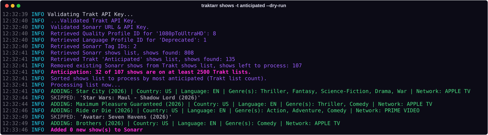
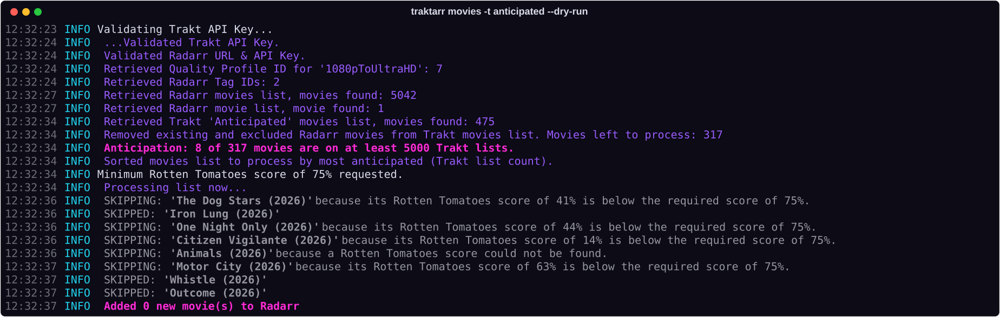

<p align="center"></p>

<p align="center">
  <a href="https://github.com/Jarsky/traktarr/actions/workflows/ci.yml"></a>
  <a href="LICENSE.md"></a>
  
  
  
  <a href="https://github.com/l3uddz/traktarr"></a>
</p>

# traktarr

Adds new movies and shows to Radarr and Sonarr from Trakt's anticipated, popular, trending and box office lists, filtered by
language, country, genre, release date, buzz, network, runtime and Rotten Tomatoes score.

A maintained fork of [l3uddz/traktarr](https://github.com/l3uddz/traktarr) (unmaintained since 2023), built on
[notlimahrelyt/traktarr](https://github.com/notlimahrelyt/traktarr)'s port to current Python. It works with Trakt's 2026 API
changes, current Radarr and Sonarr v4+, and adds date, anticipation and allowed-genre filters, a colour console and fixes
for runs that used to hang. See [what's changed](#changes-in-this-copy). Licensed GPL-3.0, like the original.

<p align="center">
  
</p>

## Contents

- [Create a Trakt API key](#create-a-trakt-api-key)
- [Install with Docker Compose](#install-with-docker-compose)
- [Configure](#configure)
- [Filter examples](#filter-examples)
- [Filter reference](#filter-reference)
- [Keeping unwanted titles out](#keeping-unwanted-titles-out)
- [Commands](#commands)
- [Console colours](#console-colours)
- [Updating](#updating)
- [Changes in this copy](#changes-in-this-copy)

## Create a Trakt API key

Since mid-2026, Trakt only accepts API apps from verified developers, and it disabled many older apps, which then answer
every request with `403 Forbidden`. If traktarr logs `Aborting due to failure to validate Trakt API Key`, create a new app:

1. Sign in at [trakt.tv](https://trakt.tv) and open **Settings → Your API Apps** (the developer portal).
2. **Link your GitHub account** to your developer profile. This is currently the only verification needed to create an app,
   and from **1 January 2027** apps without a linked GitHub account become unapproved.
3. Create a new application:

   | Field | Value |
   |---|---|
   | Name | anything, e.g. `traktarr` |
   | Redirect URI | `http://localhost/callback`. Development apps only allow localhost, and traktarr never uses it |
   | Allowed origins | leave empty. They only matter for apps running in a web browser |
   | Permissions (check-in, scrobble) | leave unticked |

4. Copy the **Client ID** into `trakt.client_id` in `config.json`. Development apps sign in with PKCE and get **no client
   secret**; leave `trakt.client_secret` empty.

The anticipated, popular, trending and box office lists only need the client ID. Watchlists and private lists also need
`traktarr trakt_authentication` (a device code you enter at trakt.tv/activate); a development app allows its owner and up to
50 invited users to sign in.

Check the key works:

```bash
curl -s -o /dev/null -w "%{http_code}\n" -H "trakt-api-version: 2" -H "trakt-api-key: YOUR_CLIENT_ID" \
  -A traktarr "https://api.trakt.tv/movies/anticipated?limit=1"     # 200 = good, 403 = app disabled or unapproved
```

## Install with Docker Compose

```bash
sudo mkdir -p /opt/traktarr && sudo chown "$USER" /opt/traktarr
git clone https://github.com/Jarsky/traktarr.git /opt/traktarr
cd /opt/traktarr
cp docker-compose.example.yml docker-compose.yml
cp .env.example .env                    # set your time zone
docker compose up -d --build
```

On first start, traktarr writes a default `config/config.json` and stops. [Fill it in](#configure), then
`docker compose up -d` again and watch it with `docker logs -f traktarr`.

```
/opt/traktarr/
├── docker-compose.yml   your copy of docker-compose.example.yml
├── .env                 your copy of .env.example: time zone, colour, config folder
├── config/              config.json, cache.db, traktarr.log
└── …                    the source
```

Your `docker-compose.yml`, `.env` and `config/` aren't tracked by git, so `git pull` never touches them.

| `.env` | Default | |
|---|---|---|
| `TZ` | `Etc/UTC` | your time zone; log times and "this year" in the filters follow it |
| `TRAKTARR_COLOR` | `1` | colour in `docker logs`; `0` for plain text |
| `CONFIG_DIR` | `./config` | where `config.json`, `cache.db` and `traktarr.log` live |
| `DOCKER_NETWORK` | `media` | only with the networks section enabled (below) |

### Reaching Radarr and Sonarr

traktarr talks to Radarr and Sonarr over their APIs. Either:

- **Use their address** in `radarr.url` / `sonarr.url`, e.g. `http://192.168.1.10:7878/`. Works wherever they run, with
  the compose file above as it is.
- **Or join their Docker network** and use their container names (`http://radarr:7878/`). Find the network with
  `docker inspect radarr --format '{{range $k, $v := .NetworkSettings.Networks}}{{$k}} {{end}}'`, set
  `DOCKER_NETWORK` in `.env`, and uncomment the two `networks` parts of your `docker-compose.yml`.

`localhost` doesn't work from inside the container: it means the container itself.

`run` waits one interval before its first check, so restarting the container (updates, reboots) never adds an extra batch.
`["run", "--run-now"]` checks the lists immediately on every start instead. To check once now without changing that, use
the one-off commands under [Commands](#commands).

## Configure

The parts of `config.json` you need to fill in (the [filters](#filter-examples) come with sensible defaults):

```jsonc
{
  "trakt":  { "client_id": "YOUR_CLIENT_ID", "client_secret": "" },
  "omdb":   { "api_key": "YOUR_OMDB_KEY" },          // free key from omdbapi.com; only for the Rotten Tomatoes filter
  "radarr": {
    "url": "http://192.168.1.10:7878/",              // see "Reaching Radarr and Sonarr"
    "api_key": "…",                                  // Radarr → Settings → General
    "quality": "HD-1080p",                           // one of your quality profiles (case doesn't matter)
    "root_folder": "/movies",                        // a root folder as Radarr shows it, not as traktarr sees it
    "minimum_availability": "released",
    "tags": ["traktarr"]                             // tag everything it adds (create the tag in Radarr first)
  },
  "sonarr": {
    "url": "http://192.168.1.10:8989/",
    "api_key": "…",
    "quality": "HD-1080p",
    "language": "Deprecated",                        // Sonarr v4+: keep "Deprecated". Sonarr v3: a language profile name
    "root_folder": "/tv",
    "tags": ["traktarr"]
  }
}
```

The quality profile, root folder and tag must already exist in Radarr/Sonarr, otherwise adding fails; check
`docker logs traktarr` on the first run.

Changes to `config.json` take effect when the container restarts: `docker restart traktarr`.

## Filter examples

### How many get added

Each number in `automatic` is a **per-run limit for that list** (`0` turns the list off), and a run happens every
`interval` hours. The daily maximum is the sum. Within each list traktarr adds the best-ranked titles that pass every
filter: the anticipated list by Trakt list count, the others by votes.

```jsonc
"automatic": {
  "movies": { "interval": 24, "anticipated": 1, "popular": 1, "boxoffice": 1, "trending": 0 },   // ≤ 3 movies a day
  "shows":  { "interval": 24, "anticipated": 1, "popular": 0, "trending": 0 }                     // ≤ 1 show a day
}
```

For TV, the anticipated list is where the big new series are (Harry Potter, Blade Runner 2099, Neuromancer on tens of
thousands of Trakt lists); popular leans towards whatever already aired.

The original defaults (20 anticipated + 5 popular + 3 box office + 2 trending) add up to 30 movies a day.

### Movies: new, English, blockbuster genres, well reviewed

```jsonc
"filters": {
  "movies": {
    "allowed_languages": ["en"],
    "allowed_countries": ["us", "gb", "ca", "au", "nz"],
    "allowed_genres": ["action", "adventure", "comedy", "fantasy", "horror", "science-fiction", "superhero"],
    "blacklisted_genres": ["anime", "children", "documentary", "music", "musical", "reality", "short", "sports",
                           "holiday", "history", "special-interest"],     // no "drama": allowed_genres keeps pure dramas out
    "blacklisted_title_keywords": ["concert", "sing-along", "the making of", "untitled", "wwe", "ufc"],
    "blacklisted_min_year": "{year}",   // this year…
    "blacklisted_max_year": "{year}+1", // …to next year, so it never needs updating
    "released_after": "-6mo",           // released in the last 6 months…
    "released_before": "+18mo",         // …or coming in the next 18 months
    "blacklisted_min_runtime": 80,
    "rotten_tomatoes": "75",            // released movies need this score, from any list; unreleased ones are exempt
    "anticipated_min_lists": 5000       // anticipated list: only titles on at least this many Trakt lists
  }
}
```

### Shows: new series only, no procedurals or reality TV

```jsonc
"filters": {
  "shows": {
    "allowed_languages": ["en"],
    "allowed_countries": ["us", "gb", "ca", "au", "nz"],
    "allowed_genres": ["action", "adventure", "comedy", "fantasy", "horror", "science-fiction", "superhero"],
    "blacklisted_genres": ["animation", "anime", "children", "documentary", "game-show", "home-and-garden", "news",
                           "reality", "soap", "special-interest", "talk-show", "sporting-event"],   // drop "animation"
                                                                                 // to allow e.g. Star Wars animated series
    "blacklisted_networks": ["youtube", "twitch", "nickelodeon", "hallmark", "cartoon network"],
    "blacklisted_min_year": "{year}",   // first aired this year or later: new series, not new seasons
    "blacklisted_max_year": "{year}+1",
    "blacklisted_min_runtime": 15,
    "anticipated_min_lists": 2500
  }
}
```

### How the genre filters combine

- `allowed_genres`: a title needs **at least one** of these. Leave it out or empty to allow any genre.
- `blacklisted_genres`: a title with **any** of these is skipped, even if it also has an allowed genre.
- So to allow dramas only when they're also something you want, leave `drama` **out** of both lists:

  | Trakt genres | Result |
  |---|---|
  | drama, science-fiction | ✅ has an allowed genre |
  | drama | ❌ no allowed genre (e.g. a medical or legal drama) |
  | thriller, drama, crime | ❌ unless you allow thriller or crime |
  | horror, romance | ✅ |
  | animation, science-fiction (TV) | ❌ animation is blocked for TV |
- Genre names are Trakt's slugs:

  | | |
  |---|---|
  | Movies | action adventure animation anime comedy crime documentary donghua drama family fantasy history holiday horror music musical mystery romance science-fiction short sporting-event superhero suspense thriller war western |
  | Shows | the movie list plus biography children game-show home-and-garden mini-series news reality soap special-interest talk-show |

  Fetch the current lists with `curl -H "trakt-api-version: 2" -H "trakt-api-key: …" https://api.trakt.tv/genres/movies`
  (or `/genres/shows`).

### Years and dates

`blacklisted_min_year` / `blacklisted_max_year` take a fixed year (`2026`) or one relative to the current year:
`"{year}"` is this year, `"{year}+1"` next year, `"{year}-2"` two years ago (`0`, `"+1"`, `"-2"` also work).

`released_after` / `released_before` filter on the exact date: a movie's release date, a show's first-aired date. They
take a date (`"2026-06-01"`), `"today"`, or a distance from today: `"-3mo"`, `"+12mo"`, `"-90d"`, `"-2w"`, `"+1y"`
(`"-3 months"` works too). Leave them out for no limit. A title with no date yet is skipped when either is set.

For shows, years and dates are when the series first aired, so these filters pick new series, not new seasons.

### Anticipated titles

Unreleased titles have no reviews and few votes, so the anticipated list is ranked by **list count**: how many Trakt users
have the title on a list. Blockbusters are on tens of thousands (Avengers: Doomsday 76k, Dune: Part Three 55k); small
releases on a few hundred. `anticipated_min_lists` drops anything below your threshold.

The Rotten Tomatoes minimum is skipped only while a movie is unreleased. Trakt's anticipated list also contains films
already in cinemas, and those need the score like any other:

<p align="center">
  
</p>

### Trying changes

Run a list once with `--dry-run` to see what your filters would add, without adding anything. One-off commands don't read
`allowed_genres` or `rotten_tomatoes` from the automatic settings, so pass them with `-g` and `-rt`:

```bash
docker compose run --rm traktarr movies -t anticipated -l 3 -g "action,adventure,comedy,fantasy,horror,science-fiction,superhero" -rt 75 --dry-run
docker compose run --rm traktarr shows  -t anticipated -l 3 -g "action,adventure,comedy,fantasy,horror,science-fiction,superhero" --dry-run
```

A dry run doesn't stop at the limit, so it lists every title that would qualify, best first.

## Filter reference

Every filter lives under `filters.movies` or `filters.shows`. A title must pass all of them.

| Setting | Movies | Shows | What it does | Example |
|---|:-:|:-:|---|---|
| `allowed_languages` | ✓ | ✓ | original language must be one of these; `["ignore"]` also allows titles with none set | `["en"]` |
| `allowed_countries` | ✓ | ✓ | production country must be one of these; `["ignore"]` also allows titles with none set | `["us", "gb"]` |
| `allowed_genres` | ✓ | ✓ | needs **at least one** of these genres; empty = any | `["science-fiction", "horror"]` |
| `blacklisted_genres` | ✓ | ✓ | skipped if it has **any** of these genres | `["reality", "documentary"]` |
| `blacklisted_networks` | | ✓ | skipped if it airs on one of these | `["youtube", "hallmark"]` |
| `blacklisted_title_keywords` | ✓ | ✓ | skipped if the title contains one of these (not case-sensitive) | `["concert", "wwe"]` |
| `blacklisted_min_year` | ✓ | ✓ | earliest year (shows: year first aired) | `"{year}"`, `2026` |
| `blacklisted_max_year` | ✓ | ✓ | latest year | `"{year}+1"` |
| `released_after` | ✓ | ✓ | released / first aired on or after this date | `"-6mo"`, `"2026-01-01"` |
| `released_before` | ✓ | ✓ | released / first aired on or before this date | `"+18mo"`, `"today"` |
| `blacklisted_min_runtime` | ✓ | ✓ | shortest runtime in minutes (titles without a runtime are skipped) | `80` |
| `blacklisted_max_runtime` | ✓ | ✓ | longest runtime in minutes; `0` = no limit | `0` |
| `rotten_tomatoes` | ✓ | | minimum Rotten Tomatoes % for released movies (needs `omdb.api_key`); `""` = off | `"75"` |
| `anticipated_min_lists` | ✓ | ✓ | anticipated list only: minimum number of Trakt lists the title is on | `5000` |
| `blacklisted_tmdb_ids` | ✓ | | never add these TMDb IDs | `[12345]` |
| `blacklisted_tvdb_ids` | | ✓ | never add these TVDB IDs | `[67890]` |
| `disabled_for` | ✓ | ✓ | lists that skip all the filters above: `"popular"`, `"watchlist:USER"`, `"list:URL"` | `["watchlist:USER"]` |

Dates take `"YYYY-MM-DD"`, `"today"`, or a distance from today with `d`, `w`, `mo` or `y`: `"-90d"`, `"-2w"`, `"-3mo"`,
`"+1y"`. Years take a year or `"{year}"` with an optional `+N` / `-N`.

## Keeping unwanted titles out

- traktarr skips anything already in Radarr/Sonarr **and anything on their import exclusion lists**. When you delete
  something it added, tick **Add to import exclusion list** so it doesn't come back.
- Tag what traktarr adds: set `radarr.tags` / `sonarr.tags` to a list of tag names (e.g. `["traktarr"]`), then filter by
  the tag in Radarr/Sonarr to review everything it has added.
- Try filter changes with `--dry-run` first (see [Commands](#commands)).
- To block a single title, add its TMDb ID to `filters.movies.blacklisted_tmdb_ids` or its TVDB ID to
  `filters.shows.blacklisted_tvdb_ids`. Title words go in `blacklisted_title_keywords`.

## Commands

Run any of these as a one-off with `docker compose run --rm traktarr <command>`:

```bash
movies -t popular -l 5 --dry-run           # show what would be added from a list, without adding anything
movies -t popular -l 5                     # add up to 5 movies (lists: anticipated, trending, popular, boxoffice)
movies -t anticipated -l 5 -g "science-fiction,horror"    # only these genres, this time
shows  -t anticipated -l 1 -g "science-fiction,fantasy"   # add 1 show now, outside the daily schedule
movies -t https://trakt.tv/users/NAME/lists/LIST -l 10    # any public Trakt list
trakt_authentication                       # sign in, for watchlists and private lists
```

`--help` after any command lists all its options.

## Console colours

The console log is short and colour-coded: titles being added in green, skipped ones dimmed, list headers in pink,
problems in red, with a neon banner at start-up. The log file (`config/traktarr.log`) keeps the full plain format.

`docker logs` isn't a terminal, so colour is switched on with `TRAKTARR_COLOR=1` in the compose file; `0` turns it off.
Set `TZ` there too, so log times and "this year" follow your time zone.

## Updating

```bash
cd /opt/traktarr && git pull && docker compose up -d --build
```

## Changes in this copy

Changes stay in this fork; nothing is sent upstream. On top of notlimahrelyt's Python 3.10+ port:

- **Python 3.12 image** (`Dockerfile`), replacing the old Python 3.7 one and its Docker Hub hooks.
- **Ready-made `docker-compose.example.yml` and `.env.example`:** clone, copy two files, start.
- **Defaults that work today:** the generated config uses this year to next year (not 2000–2019), adds at most one
  title a day per list, includes the new filters, and uses Sonarr v4+'s `"Deprecated"` language.
- **Anticipated list works with a Rotten Tomatoes minimum.** Unreleased movies have no score, so before this nothing from
  that list was ever added; now the check is skipped while a movie is unreleased.
- **Anticipated titles ranked by Trakt list count**, with an `anticipated_min_lists` minimum.
- **`released_after` / `released_before`** date filters, relative to today (`"-3mo"`) or fixed; **`{year}`** in year filters.
- **Colour console** with a neon banner (`TRAKTARR_COLOR`); the log file stays plain.
- **No more stalled runs.** Every title used to be checked by loading its themoviedb.org / thetvdb.com web page while
  pretending to be a browser, with no timeout; those requests got blocked and runs hung for hours. Now only the ID is
  checked, and Radarr/Sonarr look the title up themselves.
- **`allowed_genres`** for movies and shows.
- **Relative years keep working** across automatic runs, instead of freezing at the year the container started.
- **Honest user agent:** Trakt requests identify as `traktarr` rather than a browser.
- **`disabled_for` works for watchlists and custom lists** (`"watchlist:USER"`, `"list:URL"`); the names were never
  filled in before, so those entries never matched.
- Regex escape warnings on Python 3.12 fixed; the "No user" line no longer repeats on every request.
- **Tests and CI:** `tests/` covers the filters; GitHub Actions runs them and builds the Docker image on every push.

## Credits

[l3uddz](https://github.com/l3uddz) and the original contributors wrote traktarr; [notlimahrelyt](https://github.com/notlimahrelyt)
ported it to current Python. GPL-3.0, see [LICENSE.md](LICENSE.md).
